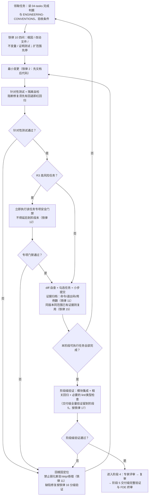

# Spec 驱动 AI 自动开发流水线（SDD Pipeline）v3.1

把 AI 从"每次从零开始的聊天机器人"变成"有规则、有流程、有专家、有记忆的工程化流水线"。

核心信念有两条：**先想清楚再动手，让 AI 不跑偏；规格明确后连续交付，让 AI 不空转。** 前者防止错误设计进入代码，后者防止工程流程自身成为瓶颈。Spec 驱动的核心不是文档多，是把技术决策从"写代码时"前移到"写文档时"——AI 实现阶段不做决策，只按图施工；而规格一旦批准，实现阶段就应连续推进，不反复确认已确定的事。v3.0 再进一步：**按风险花钱、按证据放行**——验证强度与任务风险匹配，同一版本同一范围已有有效证据就不重复跑；交付前必须补齐与当前提交对应的完整证据。

四阶段目标：**设计**把关键技术决策、业务规则、安全边界前移；**实施**严格遵循已批准规格、按依赖连续完成任务；**验证**分任务/阶段/交付/真实环境四级，用自动化测试、专家评审与真实联调证明质量；**变更**只在触及明确决策边界时才暂停并重新评审。

v2 相对初版的变化来自首次实跑复盘：专家评审在 97% 覆盖率下仍抓出 8 个阻断，复审又抓出修复引入的 3 个新阻断——本版据此强化了复审回归、测试反模式、状态机分析、专家 prompt 模板与真实联调门禁。v2.2 来自第二次实跑中反复出现的测试结构错乱、mock 污染、导入问题与"修一个坏一个"，把散落的测试纪律前置为编码期硬约束：修复闭环四问、测试隔离硬规则、分层验证阶梯、禁弱化断言铁律与验收证据规范。v2.3 解决"严谨但空转"：v2.2 擅长防止 AI 擅自决策，却让规格明确后仍逐任务等待确认；本版补入阶段批量执行、风险分级、变更治理、工作区保护、外部副作用不确定结果处理，并把"文档完整"与"每次重写四文档"解耦（执行路线分流）。v2.4 修正 v2.3 遗留的四处内部矛盾：门禁频率改为按层递进（全量门禁不再挂在每个任务上，避免抵消批量执行）、工作区隔离默认不 stash 并优先 worktree、区分探索实验与正式实现、专家结论增加"无法判定"第三态。v2.5 把目标从"AI 执行、人工频繁确认"推进到"AI 自主开发、人工例外介入"：人工介入收敛为三关口（启动审批 / 决策边界 / 交付验收），四文档改为评审包合并审批，普通失败先自主诊断修复并按上限升级，R1/R2 默认不启动专家与人工。v2.6 消除 v2.5 残留的规则冲突：档位差异改为质量门禁强度而非人工确认次数、用"决策分级"表厘清自主与暂停边界、异常自愈加入有效重试与成本/时间上限、前端确认按 A/B 类分级、明确各阶段职责边界并支持大型项目按模块分批交付。v3.0 聚焦执行效率与测试优化：按风险选用流程档位（不强制所有任务走完整 SDD）、逻辑文档产物保留但小型任务允许合并、测试四级执行、同版本同范围验证证据复用、专家动态调度（不设固定人数）、缺陷修复分级验证、任务依赖驱动并行、最终交付必须取得当前提交的完整测试证据与需求/架构/验收一致性检查，禁止通过跳过测试或降低门槛伪装通过。v3.1 补齐治理层与收敛层：引入 ADR 重大决策管理（有状态、可推翻、Spec 引用，但不增加普通任务的审批负担）与独立 Converge 收敛门禁（复用当前提交的测试/评审/联调证据，不重复跑 T1–T3）。v3.1 Batch 2 接入追溯与治理分层：Requirement ID 全局唯一、REQ→ADR→TASK→TEST→EVIDENCE 全链追溯（证据锚定真实记录而非 Pass 文字）、Constitution 与 Engineering Conventions 分层（企业独立/MVP 合并）、正式交付收敛必须基于干净工作区与确定提交 SHA。v3.1 Batch 2.1 补治理闭环：Constitution 明确进入接续、Validator 与 Converge；追溯矩阵支持多对多、分号多值与反向查询；TEST ID 采用 `TEST-<模块缩写>-<三位序号>` 并全项目唯一；Converge 第 3/7 项显式拒绝不完整追溯链。

### 版本历史

| 版本 | 日期 | 关键变化 | 来源 |
|---|---|---|---|
| v1 | 2026-09 | 意图路由 SOP + 四文档 + 三层 Validator + 专家并行评审 + CI/人工门禁 | 初版骨架 |
| v2 | 2026-09-20 | 双档位、阻断回归与原专家复审、变异抽查、状态机两张表、真实联调门禁 | 首次实跑：97% 覆盖率仍有 8 阻断，修复又生 3 个 |
| v2.1 | 2026-09-20 | 断点接续协议、前端页面用户确认 | 跨会话续作断点 |
| v2.2 | 2026-10-13 | 修复闭环四问、测试隔离、分层验证阶梯、导入边界、禁弱化断言、真实证据 | 第二次实跑：测试结构/mock 污染/导入问题、修一个坏一个 |
| v2.3 | 2026-10-23 | 执行路线分流、阶段连续执行、风险分级、追溯矩阵、变更治理、现场保护、副作用不确定 | "严谨但空转"复盘 |
| v2.4 | 2026-10-23 | 门禁频率按层递进、工作区隔离改默认不 stash、探索实验与正式实现分离、专家"无法判定"第三态 | v2.3 内部矛盾审查 |
| v2.5 | 2026-10-23 | 人工三关口、评审包合并审批、异常自愈升级规则、R1/R2 默认自主 | 人工参与频率偏高复盘 |
| v2.6 | 2026-10-23 | 档位=门禁强度非确认次数、决策分级表、有效重试与成本上限、前端 A/B 分级、职责边界、模块分批交付 | v2.5 规则冲突审查 |
| v3.0 | 2026-11-24 | 按风险选流程、文档保留但可合并、测试四级、验证证据复用、专家动态调度、缺陷修复分级验证、依赖驱动并行、最终完整验证与一致性检查 | 执行效率与测试优化规则 |
| v3.1 | 2026-11-24 | Batch 1/1.1：ADR 重大决策管理（状态流转/可推翻/Spec 引用）与 Converge 独立收敛门禁（7 项检查/证据复用/CONVERGENCE.md）；Batch 2/2.1：Requirement ID/TEST ID 唯一规范、REQ→ADR→TASK→TEST→EVIDENCE 多对多追溯、EVIDENCE 锚定真实记录、Constitution 分层并接入接续/Validator/Converge、正式收敛须干净工作区 + 确定 SHA | 治理层与交付收敛层补齐（Batch 1 + 1.1 + 2 + 2.1） |

## 适用场景与档位选择

当用户要求开发一个功能、模块或完整项目并按工程化流程推进时使用。**开口先声明档位与理由**：

| 档位 | 适用 | 逻辑文档产物与审批 | 专家评审 | 测试与门禁 |
|---|---|---|---|---|
| 企业级 | 真要上线、多用户、涉钱/涉数据/涉合规 | 按风险全量深度；小型任务可合并压缩，**评审包一次人工审批** | R3 强制独立专家；R2 视风险抽查 | 交付级全量测试 + lint + 类型检查 + 构建 + 独立安全审查 + 按风险触发真实环境级验证 |
| MVP（默认） | 个人/内部/练手/单用户早期版本 | 四文档可缩短；小型任务允许合并为一份文档，**评审包一次人工审批** | R3 独立专家；R1/R2 默认自主 | 交付级全量测试与核心静态检查；R3 或外部依赖变更时触发真实环境级验证 |

**档位差异在质量门禁强度，不在人工确认次数（v2.6）**：两档都是"评审包一次确认"，企业级增加独立专家评审、独立安全审查与更严的覆盖率/联调要求。**R3 任务在任何档位、任何风险分级下都不得跳过安全门禁**。

**按风险选择流程档位（v3.0）**：不是所有任务都必须走完整 SDD 流程。任务规模、影响面与风险共同决定选用哪一档、文档深度、测试级别和专家配置；判定理由必须写在任务记录里。低风险的局部任务走轻档，只保留必需的逻辑产物与任务级验证；触及对外契约、数据、状态、安全或不可逆操作的任务必须升级档位。**档位可以变轻，铁律 11（真实证据）与铁律 17（完整交付验证）不打折**。

**逻辑产物保留，审批精简（v3.0）**：分析、需求、设计、任务四类逻辑产物不能缺失，但允许小型任务合并为一份简短文档（如 `SPEC-TASK.md`），不必强凑四个文件。人工审批集中在需求范围、重大架构决策、高风险变更和最终交付；其余按决策分级自主推进。明确说"先写个 demo 不管质量"、20-30 分钟现场验证客户想法的，**不要走本 skill**，用 fde-flash-demo。

不适用于：一次性问答、纯咨询。

### 执行路线分流（v2.3，防"文档完整"被误解为"每次重写四文档"）

逻辑产物不可省指的是"每个新模块/新功能都要想清楚分析、需求、设计与任务"，**不是**每次小改动都写四份文件、走完整流程（v3.0）。按改动性质与风险选路线：

| 场景 | 执行方式 |
|---|---|
| 新模块 / 新功能 | 完整四文档 → 评审 → 实施 → 验收 |
| 既有模块的小型 Bug 修复 | 读现有 Spec，补一份**问题分析 + 修复方案 + 回归测试**（可写在 `ISSUES.md`、`04-tasks.md` 追加条目，或合并为单文件 `SPEC-TASK.md`），不新建四文档 |
| 影响接口/数据模型/状态迁移/安全边界的 Bug | 先更新受影响的 Spec 章节，按风险级别评审后再改代码 |
| 线上事故 | 先按 SOP 9 止血与数据保护，再补根因分析与正式修复 |

**判定标准**：改动是否触及对外契约、持久化结构、状态机迁移、权限/安全边界、验收标准。触及即升级为"先改 Spec"路线；纯内部实现调整走轻量路线。轻量路线**仍受铁律 10/11/15/16、测试四级执行与证据要求约束**——省的是文档篇幅，不是质量门禁。

## ADR 架构决策管理（v3.1，治理层）

**适用范围（防负担铁律）**：只有**重大架构、数据模型、权限模型、安全边界、关键技术路线**决策才需要 ADR。普通实现细节、局部重构、已批准方案内的技术选择**不创建 ADR**。简单 MVP 或无此类决策的任务可在评审包中标注 `ADR: N/A` 并说明理由；ADR 不是新的审批队列，合并进关口 1 / 关口 2 的既有审批，不额外增加人工确认次数。

### 何时必须建 ADR
- 涉及核心架构、技术选型（框架/存储/通信范式）、数据模型或持久化边界；
- 涉及认证授权模型、租户隔离、审计策略等安全边界；
- 推翻或实质性修改已接受的架构决策；
- 企业级 R3 任务中的任何架构级变更。

### 文件与状态
`docs/adr/` 下按 `0001-architecture-baseline.md`、`0002-authentication-strategy.md` 顺序编号，一旦创建不重命名、不覆盖。每个 ADR 必须包含：背景与问题、决策、备选方案（≥2，含拒绝理由）、理由与后果（含风险与后续影响）、状态、关联 Spec / 变更单。

**状态流转（完整迁移表）**：

| 从状态 | 允许迁移到 | 说明 |
|---|---|---|
| Proposed | Accepted / Rejected | 审批通过或拒绝 |
| Accepted | Deprecated / Superseded | 被废弃（无替代）或被新决策替代 |
| Rejected | —（终态） | 已拒绝；如需重新提案，另建新 ADR |
| Deprecated | —（终态） | 已废弃；如需恢复，另建新 ADR |
| Superseded | —（终态） | 已被替代；后续演进由替代它的 ADR 继续 |

**Deprecated 与 Superseded 的区别**：`Deprecated` 表示决策不再有效但**没有明确替代方案**（例如功能取消、技术路线废弃）；`Superseded` 表示决策被**一个新的、明确指定的 ADR 取代**。二者均为终态，不可互相迁移。

**已 Accepted 的 ADR 不允许直接改写历史决策**——新决策推翻旧决策时创建新 ADR，在新 ADR 中写明 `Supersedes: ADR-xxxx`，在旧 ADR 中写明 `Superseded by: ADR-yyyy`，并将旧 ADR 状态**直接从 Accepted 更新为 Superseded**（无需先经过 Deprecated）。替代关系必须双向记录，旧 ADR 原文保留。

### 与 Spec / 实现的关系
- `01-analysis.md` 的选型对比、`03-design.md` 的关键决策应引用相关 ADR 编号；重大决策在方案定稿时同步建 ADR，不事后补写。
- 实现阶段发现原 ADR 不合理：不擅自改代码绕过，走"变更治理"登记影响单；需要推翻 ADR 时升级关口 2 决策，按上述状态流转创建新 ADR。
- Spec 中引用了 Superseded / Deprecated 的 ADR 时，一致性检查与 Converge 视为冲突项，必须先更新 Spec 或说明兼容性理由。

### ADR 模板（最小结构）
```
# ADR-0001: <决策标题>
- 状态: Proposed | Accepted | Rejected | Deprecated | Superseded
- 日期: <YYYY-MM-DD>
- 决策人/审批: <人>
- Supersedes / Superseded by: <ADR 编号或 N/A>

## 背景与问题
## 决策
## 备选方案（≥2，每个含放弃理由）
## 理由与后果（风险、约束、后续影响）
## 关联 Spec / 任务 / 变更单
```

---

## Constitution 与 Engineering Conventions 分层（v3.1 Batch 2，项目治理分层）

将项目约束分成两层，避免长期原则与技术配置混写：

| 文档 | 定位 | 变更频率 | 内容示例 |
|---|---|---|---|
| `docs/CONSTITUTION.md` | 项目长期不可突破的原则与授权边界 | 极低 | 不许绕过统一授权服务；业务层不得直连底层 DB；Agent 执行阶段不得自行扩大权限；关键操作必须可审计；未经批准不得改核心架构 |
| `docs/ENGINEERING-CONVENTIONS.md` | 具体技术栈、编码约定、工具与工程配置 | 中 | 语言/框架、测试框架、Lint/格式化、API 错误结构、覆盖率阈值 |

**分档规则**：企业级两个文件必须分离；MVP 允许在 `ENGINEERING-CONVENTIONS.md` 中用独立的 `## Constitution 原则` 小节承载长期原则，不再新建文件。无论分档，长期原则部分都必须被 Validator 第三层与 Converge 第 4/5 项检查明确核对（企业级读取 `CONSTITUTION.md`；MVP 读取合并章节）。

**关系**：Constitution 是 ADR 的边界输入——ADR 不得违反 Constitution；确需突破时必须先修订 Constitution（走变更治理与关口 2 审批），再创建新 ADR。Constitution 与 ADR 冲突时，以 Constitution 为准并触发变更流程。

---

## 铁律（任何阶段不可违反）

1. **文档未通过审核，不写一行正式实现代码。**"文档"按执行路线分流定义：新功能指四文档；小型 Bug 修复指问题分析+修复方案+回归测试（可合并为单文件）；触及契约/数据/状态/安全边界的改动指更新后的受影响 Spec 章节（见"执行路线分流"）。分析、需求、设计、任务四类逻辑产物始终要有载体，但小型任务允许合并文档、精简审批。**探索性实验例外（v2.4）**：为验证技术可行性而写的一次性代码可在明确隔离的临时目录或临时分支进行，不得混入正式实现，实验结果不得作为验收证据；一旦实验结论改变技术选型或架构假设，必须先更新 Spec 并审批，再进入正式实现。
2. **文档是单一事实源**：争议回文档；任何变更，先改文档再改代码。
3. **门禁不可跳过（强度按风险动态选择，见 4.0）**：Validator 自检对所有任务必需；专家评审按变更影响范围与风险动态调度，**不设固定专家人数**。Validator 不过不提交；已启动的评审有未决阻断不提交（人类明确豁免的必须记录在案）。"不启动专家评审"不是"跳过门禁"——针对性测试与阶段级验证照常。
4. **AI 在实现阶段不做"改变契约"的技术决策**（v2.6 按决策类型分级，见阶段 2"决策分级"）：已授权的实现决策与不改变契约的局部调整由 AI 自主完成并记录；改变业务语义/接口/安全边界/核心架构的，必须停下提 issue 并请人决策，不擅自决定。
5. 所有产出使用项目 `docs/` 目录统一管理。
6. **阻断修复必须配"回退即红"的回归测试，并由原打回专家定点复审。**（v2 新增，v3.0 按风险分级：高风险修复另加独立复审与变异验证，见铁律 16、阶段 4）
7. **mock 全绿不等于可交付**：凡依赖外部服务（LLM、支付、第三方 API），必须过真实联调检查点。（v2 新增）
8. **断点接续先读文档再动手**：新会话进入已开工的项目，未完成"接续协议"禁止编码。（v2.1 新增，见下节）
9. **前端页面确认按类型分级**（v2.1 新增，v2.6 分级）：**A 类**（新产品/面向客户的关键页面）形态、风格、布局与关键交互未经用户明确确认，不进设计定稿、不写代码；**B 类**（已有设计规范下的常规页/内部后台）由 AI 依设计系统自主设计、交付时集中验收，仅在缺业务决策/明显歧义/重大体验取舍时中途询问。
10. **修复走闭环，动手前先答四问**（v2.2 新增）：根因是什么？计划改哪些文件？哪些行为必须保持不变（不变量）？用什么测试证明修复有效？固定流程 `复现 → 定位根因 → 最小修改 → 针对性测试 → 必要回归（按风险级别，同版本同范围有效证据可复用） → 检查 diff`；修复中需要扩大改动范围，先停下说明原因再继续，禁止顺手重构无关代码。
11. **禁止以改测试换绿灯，验收只认真实证据**（v2.2 新增）：不得通过修改测试、放宽断言、skip/xfail、吞掉错误让测试变绿；改测试必须声明性质——"修正错误的测试假设"还是"验证新增业务行为"。**安全、权限、审批、审计四类断言一律不得弱化**。"测试通过"不得作为验收结论：必须附实际执行的命令、退出码、用例数与覆盖率数字（或真实运行记录），AI 自述不算证据。
12. **任务依赖驱动执行，阶段内连续推进**（v2.3 新增，v3.0 明确并行）：审批通过后，AI 按任务依赖连续完成当前阶段全部可执行任务，**无依赖任务允许并行**（不同文件、不同测试环境、不同资源）；存在代码、接口、数据或资源冲突的任务必须串行协调或合并为一个任务，禁止并行写同一文件/共享可变状态。**不逐任务等待用户批准**；每个任务仍须独立验证、更新勾选状态、留下提交记录。仅当出现以下情形才暂停：架构决策变化、Spec 歧义、安全/权限边界变化、按"异常自愈"规则判定为真实阻塞的失败、超出授权范围。普通实现问题、可逆技术选择、局部测试失败由 AI 自主诊断修复，不升级为人工问题。**门禁按层递进（v2.4，v3.0 四级）**：每个任务只跑针对性测试与必要快速检查；模块集成与相关回归在阶段末；全量测试/lint/类型检查/构建/覆盖率与需求-架构-验收一致性检查在交付前集中执行；**但 R3 高风险任务的专项安全门禁必须在任务内立即执行，不得因阶段未结束而延后**。各级验证的具体命令由 `ENGINEERING-CONVENTIONS.md` 决定，同一版本同一范围已有有效证据可复用（铁律 15）。
13. **保护工程现场，不碰不属于本任务的变更**（v2.3 新增）：开工前记录分支、HEAD、工作区状态与既有改动；不得覆盖、重置或提交不属于当前任务的改动（含未提交文件、他人的在途修改）。执行与提交必须记录真实命令与退出结果，并如实标注状态——已执行通过 / 未执行 / 环境阻塞 / 部分通过，禁止用旧结果冒充当前结果。安全机制或命令被拦截时不得绕过，须记录阻塞原因并选安全替代路径。**隔离默认不 stash（v2.4）**：默认保留现有工作区改动，不执行 `stash`/`reset`/`clean`/`checkout` 等会改变他人工作状态的操作；确需隔离时，先确认文件归属、取得授权并记录恢复方式，优先用独立 worktree 而非 stash。
14. **外部副作用不确定时，先查后动**（v2.3 新增）：支付、ERP/外部系统写入、审批、消息发送等有副作用的操作，在超时或连接中断后**不得默认失败并自动重试**；必须先用幂等键、查询接口或对账协议确认实际状态。无法确认时进入 `uncertain` / 待人工核对状态，禁止重复执行。该要求必须落到设计（幂等与恢复协议）、实现（状态查询与不确定态）与联调测试。
15. **同一版本同一范围不重复验证**（v3.0 新增）：已有有效验证证据（代码版本、配置、环境与依赖未变，测试范围相同，命令与结果可复核）时直接复用，禁止为"走流程"重复执行相同测试；任一项发生变化，必须重新判断旧证据是否有效并按需重跑。复用时须注明证据来源与适用版本，不得用旧结果冒充当前提交的结果（铁律 13）。
16. **缺陷修复分级验证**（v3.0 新增）：所有缺陷修复必须有对应回归测试（铁律 6 的"回退即红"）；权限、安全、状态机、数据一致性等高风险修复，必须增加独立复审和必要的变异验证——由未参与修复的专家或 AI 复审人验证修复是否引入新问题，并通过临时改坏/删除修复代码确认回归测试确实会失败。低风险修复由任务级回归测试 + diff 自查闭环即可。
17. **最终交付必须完整验证**（v3.0 新增）：交付前必须取得与当前提交对应的完整测试证据（全量测试、Lint、Type Check、Build，以及按风险触发的真实环境级验证），并完成需求、架构与验收的一致性检查。所有跳过项必须说明原因并获记录；测试失败不得通过跳过测试、放宽门槛或降低标准伪装通过（铁律 11）。

---

## 接续协议（断点恢复，新会话强制）

触发：项目已存在 `docs/specs/` 或已有代码，无论用户说"继续做"还是直接甩来一个 bug/需求——包括上一个会话做到一半、换设备、上下文被压缩后的所有情形。

**禁止从代码反推意图后直接动手。** 代码只记录"是什么"，文档才记录"为什么"以及"哪些方案已被驳回"；跳过这一步会重复提出已否决方案、接错任务、复活已修阻断。

固定动作：

1. 按序读取：`01-analysis → 02-requirements → 03-design（重点读修订记录/§10 尾部，了解最近变更）→ 04-tasks（找第一个未勾选任务、阻塞标记、T1 对账结论）→ docs/adr（重大决策与其状态）→ Constitution（企业级 `docs/CONSTITUTION.md`；MVP 读取 `docs/ENGINEERING-CONVENTIONS.md` 的 `## Constitution 原则` 小节）→ docs/reviews 最新一轮评审结论与残余项 → ISSUES.md 未决条目 → ENGINEERING-CONVENTIONS → 近期 git log`。
2. 输出一段**接续确认**请用户核对：当前所处阶段与档位、下一任务编号及其完成判据、未决阻断/残余风险、环境前置（.env、服务需重启、凭据等）。接续确认是**一次集中确认**（关口 1 的延伸），确认后即连续执行，不再逐任务请示。
3. 确认后才允许编码。读档中发现代码与文档冲突，走 SOP 6（一致性检查）并按铁律 2 先改文档；发现文档本身缺失或过期，先补齐再继续，不许"将错就错"。

**Constitution 缺失处理（v3.1 Batch 2.1）**：先判断当前项目档位与适用规则，不得自行假定 `CONSTITUTION.md` 存在或原则为空。企业级缺少独立文件，或 MVP 在 `ENGINEERING-CONVENTIONS.md` 中找不到 `## Constitution 原则` 时：确有适用长期原则的，按文档缺失先补齐；确实没有适用原则的，记录判断理由后才可继续。

**轻量接续（v2.3，仅限小型 Bug 修复）**：若判定走"执行路线分流"中的小型 Bug 修复路线，只读该模块的 `03-design`/`04-tasks`、相关评审记录与适用 Constitution 原则（企业级 `docs/CONSTITUTION.md`；MVP 合并章节），输出一段简短确认（问题定位、拟改范围、回归测试方案），不必逐份通读全部四文档，也无需重走 APPROVED 流程。一旦发现改动触及契约/数据/状态/安全边界，立即升级为完整接续。

项目方配合义务：四文档、评审记录、ISSUES、任务勾选状态必须保持真实——接续协议的有效性完全依赖文档可信。

---

## 阶段总览

```
0. 意图识别 → 路由到 SOP（同时声明企业级/MVP 档位）
1. 逻辑产物（默认四文档，小型任务可合并为一份）→ 评审包合并审批【人工关口 1】
2. T1 环境对账 → 按任务依赖连续实施（无依赖并行/有冲突协调；含任务拆分、编码、测试、自愈、提交；只在决策边界暂停）
3. 三层 Validator 自检（提交前，已有同版本同范围有效证据则复用，不重复跑）
4. 专家 Agent 并行评审（按影响范围与风险动态调度，无固定人数）→ 修复 → 原专家复审（高风险另加独立复审/变异验证）
5. 交付级完整验证（当前提交的全量测试 + Lint + Type Check + Build）+ 需求/架构/验收一致性检查 + 按风险触发真实环境级联调 + Converge 独立收敛门禁 → 人类（FDE）终审【人工关口 3】
6. 沉淀：归档 + 复盘 + 记忆 + 回流改进本 skill
```

**人工介入三关口（v2.5，v3.0 聚焦）**：人工审批只集中在**需求范围、重大架构决策、高风险变更与最终交付**。默认每个开发阶段只在**关口 1（启动审批）**与**关口 3（交付验收）**两次集中人工确认；**关口 2（决策边界）**只在权限/租户隔离、安全风险、不可逆操作、重大架构变更、或按规则自愈失败后的真实阻塞时触发。普通实现问题、可逆技术选择、局部测试失败由 AI 自行诊断修复，不升级为人工问题。

---

## 阶段 0：意图识别与 SOP 路由

先判定意图，匹配工作流，**开口先说明"我判定走 XX 工作流（YY 档位），因为……"**，拿不准向用户确认。

| # | SOP | 触发场景 | 主要产出 |
|---|-----|---------|---------|
| 1 | 需求调研 | "帮我看看这个要怎么做"、想法阶段 | 调研报告、问题清单、范围边界 |
| 2 | 原型驱动 | 需要先确认交互/界面 | 可交互原型或页面草图 |
| 3 | PRD 输出 | 需求明确、要落产品文档 | PRD（Epic/Story + 验收标准） |
| 4 | 设计决策 | 面临技术选型/架构取舍 | 决策记录（背景/选项/结论/后果） |
| 5 | 代码开发（主线） | 文档齐备，进入实现 | 代码 + 测试 + 变更记录 |
| 6 | 一致性检查 | 代码与文档疑似脱节 | 偏差清单 + 对齐修复 |
| 7 | 文档翻译 | 文档需要给不同角色看 | 面向指定受众的文档版本 |
| 8 | 反馈跟进 | 评审/测试/用户反馈回流 | 反馈分类、处理结论、回归验证 |
| 9 | 生产问题处理 | 线上故障/Bug | 止血记录、根因分析、复盘 |
| 10 | 变更管理 | 已冻结需求发生变化 | 影响面分析、文档/代码同步变更 |
| 11 | 交付验收 | 功能完成待交付 | 验收包、交付清单、知识库归档 |
| 12 | 原型转正（v2 新增） | fde-flash-demo 验证通过、客户要立项 | 以验证过的假设为输入启动 SOP 1，**不直接在原型代码上续建** |

每条 SOP 明确四要素：触发场景、执行步骤、产出物、质量标准。下文展开主线 SOP 5。

---

## 阶段 1：Spec 逻辑产物（每个功能模块一套；默认四文档，小型任务可合并）

`docs/specs/<模块名>/` 下依次写四份（分析 → 需求 → 设计 → 任务）；小型低风险任务允许把四类内容合并为一份 `SPEC-TASK.md`，但四类逻辑产物一节都不能少。

**审批方式：评审包合并审批（v2.5 默认，v3.0 聚焦审批项）**。文档写成后，AI 汇总为一个**评审包**一次性提交人工确认——评审包包含：逻辑产物（合并时以单文件呈现四类内容）、关键决策清单（技术选型/架构/安全边界/不做清单）、风险与未决疑问、需人拍板的独立重大决策（如有）。人工审批集中在需求范围、重大架构决策、高风险变更与最终交付；其余不必逐份、逐阶段反复确认。

- **例外**：存在多个相互独立的重大决策（如同时定架构与安全模型），才拆成多次确认；拆分的理由要写明。
- **文档内部质量不因合并而降低**：每份仍按下方结构与评审标准自查；合并的是"人工确认的次数"，不是"文档的深度"。
- 评审包确认记录写入 `APPROVED.md`（确认人、日期、确认范围、遗留疑问）。

### 1.1 分析文档 `01-analysis.md`
- 背景与目标：解决什么、不解决什么（边界）
- 可行性：技术可行性、依赖条件、成本粗估
- 技术选型：≥2 个候选，按复杂度/性能/生态/熟悉度/维护成本对比，给结论与理由
- 风险表（风险/概率/影响/缓解/责任人），标注 Top 风险
- 结论：继续 / 需预研 / 放弃

### 1.2 需求文档 `02-requirements.md`
- 功能清单与优先级（P0/P1/P2）、依赖关系
- **Requirement ID 全局唯一规范（v3.1 Batch 2）**：每条需求、安全约束、验收条件都必须有全项目唯一且不可复用的 ID。格式 `REQ-<模块缩写>-<三位序号>`（需求）、`SEC-<模块缩写>-<三位序号>`（安全/权限约束）、`ACC-<模块缩写>-<三位序号>`（关键验收条件）。ID 一经分配不得复用；需求废弃时保留 ID 并标记 `Rejected`，不回收编号。所有引用（ADR/TASK/TEST/EVIDENCE）均使用该 ID。
- 业务规则（业务语言，不写实现）
- **验收标准**：每条用户故事 Given/When/Then，覆盖正常/边界/异常三路径
- 非功能需求：性能、安全、兼容、可用性，可量化
- 不做清单（Out of Scope）

评审标准：测试人员仅凭此文档能写出用例；无"大概/可能/等"模糊词；每条 P0、安全约束与关键验收条件都有唯一 ID。

### 1.3 设计文档 `03-design.md`
讲"为什么这么设计"：
- 架构：分层、依赖方向（Mermaid 图）
- API：路径、方法、schema、错误码、鉴权、幂等
- 数据模型：字段（名/类型/约束/含义）、索引、迁移
- 关键流程：时序图/状态图，含异常与回滚
- 安全设计：鉴权、权限边界、输入校验、敏感数据
- 备选方案与取舍

**v2 强制：凡涉及状态机/会话/工作流的系统，必须包含两张表：**
1. **状态字段生命周期表**：每个字段一行——首轮写入？跨轮保留？跨决策/跨会话是否清空？谁负责清？（浅合并/差量更新的框架尤其需要：漏写一个 key 就是状态污染）
2. **控制信号 × 状态组合矩阵**：skip / cancel / reset / timeout / retry / force 等信号在每个 phase 下分别路由到哪。重点标注"终态收到控制信号"的行为（这是实跑中真实出现过的安全绕过点）。

**v2 强制：响应生命周期设计**。凡 SSE/流式/长连接/Webhook，必须写明"响应头发出后发生异常如何送达客户端"——该路径绕得过全局异常处理器。

**v2.1 强制：前端页面设计（有任何用户界面时）。** 页面设计不是编码阶段的事，是设计文档的一部分。**确认强度按页面类型分两级（v2.6）**：

**A 类：新产品 / 面向客户的关键页面 —— 人工确认**。写页面设计前，用结构化提问（AskUserQuestion 或等价方式）与用户逐项确认：受众与使用场景（设备/环境/暗色模式）、风格基调、页面清单与导航骨架、每页信息层级与核心元素、关键交互三态（加载/空/错、流式呈现、在途锁、出错回填、刷新恢复）、可访问性与浏览器约束。用户答不上来的项，给 2-3 个带取舍的方案让其选择。低保真先行（线框/静态原型），确认布局与元素后再进高保真与实现。

**B 类：已有设计规范下的常规页面 / 内部管理后台 —— 默认自主**。AI 依据现有设计系统与 CONVENTIONS 自主完成设计（沿用既有布局模式、组件、间距/配色令牌），写入设计文档"前端设计"小节后直接进入实现；**交付时集中验收，不在中途逐项确认**。仅在缺少必要业务决策、存在明显歧义或涉及重大体验取舍时才中途询问。

无论哪类，设计文档必须含"前端设计"小节：页面清单与跳转图、每页布局与信息层级、关键交互与三态行为、样式基调与设计变量、组件清单、XSS 与存储安全基线（引用 Validator 前端硬清单）。纯后端/CLI 项目标 N/A 并写明理由。

**确认即冻结**：已确认（A 类）或已定稿（B 类）的页面设计与 API 契约同级；后续改页面走铁律 2（先改文档，注明原因，再改代码）。

评审标准：每个关键决策可追溯到分析文档；另一工程师无需提问即可开工；两张表无空格（N/A 也要写理由）；**A 类页面设计可追溯到真实用户确认，B 类可追溯到所用设计系统与页面说明**。

### 1.4 任务文档 `04-tasks.md`
- 每任务：编号、标题、具体操作、涉及文件、依赖、完成判据、**风险等级 R1/R2/R3（v2.3）**
- 粒度：≤ 半天、可独立验证
- 排序：骨架（目录/契约/数据结构）→ 实现 → 测试 → 收尾
- 每步注明验证命令与要更新的文档
- **T1 固定为"环境对账"（v2 新增）**：第一件事是探测实际运行时/框架版本，与设计假设逐项核对，偏差当场登记 ISSUES 并改文档，不许带着错误假设写下去
- 提交计划：任务 ↔ commit 对应关系

逻辑产物全过后建 `APPROVED.md`（评审人、日期、确认范围），方可实施。

**v2.3 强制、v3.1 Batch 2 升级：全链追溯矩阵。** 在 `04-tasks.md` 末尾（或独立 `TRACEABILITY.md`）维护一张表，**只强制覆盖 P0 需求、全部安全/权限/审批约束、关键验收条件**，不做全量台账。追溯链为 `REQ → ADR → TASK → TEST → EVIDENCE`：

| Req/SEC/ACC ID | ADR ID（或 N/A） | Task ID | Test ID | Evidence ID（锚点） | 结论 |
|---|---|---|---|---|---|
| REQ-ORD-001（P0） | ADR-0002; ADR-0003 | TASK-003; TASK-004 | TEST-ORD-007; TEST-ORD-009 | EVID-012（命令输出路径 + SHA）; EVID-015（评审记录路径 + SHA） | Pass |
| SEC-ORD-003（安全） | ADR-0002 | TASK-004 | TEST-ORD-009 | EVID-015（评审记录路径 + SHA） | Pass |

**追溯链规则**：
- **Req ID**：来自 1.2 的唯一 ID；每个 P0 / 安全约束 / 关键验收条件至少一行。单元格可列多个 REQ/SEC/ACC，用分号分隔；一个 TASK、TEST 或 EVIDENCE 可以覆盖多个 REQ，同一 ID 在不同行重复出现即表示共享关系。
- **多对多与拆行**：一个 REQ 可以关联多个 ADR、TASK、TEST、EVIDENCE；一个 TASK、TEST、EVIDENCE 也可以覆盖多个 REQ。多值一律用分号 `;` 分隔；关联复杂、覆盖范围不同或证据对应关系不同时拆成多行，不得用“等/多个/见测试”省略具体 ID。
- **ADR ID**：涉及重大决策时填对应 ADR 编号；一个需求需要多个 ADR 时用分号列出。无相关决策填 `N/A` 并说明理由（该理由须与 ADR 章节的 N/A 口径一致）。引用 Superseded / Deprecated ADR 视为冲突。
- **Task ID**：实现该需求的 `04-tasks.md` 任务编号；一个需求可由多个任务实现（多行或多 Task ID），一个任务也可覆盖多个需求。
- **Test ID**：格式 `TEST-<模块缩写>-<三位序号>`（如 `TEST-ORD-007`），与 REQ 使用同一模块缩写；作用域为所属模块，序号在模块内递增，但全项目唯一、一经分配不复用。测试代码必须保留该 ID（测试名、标记或注释均可），确保能从矩阵定位到具体用例；一个测试覆盖多个需求时，在对应行重复同一 TEST ID。
- **EVIDENCE ID 与锚点**：格式 `EVID-<三位序号>`，全项目唯一不复用；一个证据可对应多个需求，多个证据用分号列出。**EVIDENCE 不得只填 "Pass"**：必须指向真实验证记录——至少包含提交 SHA、命令与退出码输出文件路径，或评审/联调记录路径；可与 Converge 的 `CONVERGENCE.md` 证据锚点交叉引用。只写"通过/失败"而无锚点、或无法定位 TEST/证据的行视为追溯不完整，Converge 第 3/7 项应判 Insufficient Evidence 或 Fail（按缺失性质）。
- **正反向追溯**：矩阵至少以 REQ 为行组织，但每个 TASK/TEST/EVIDENCE ID 必须能反查所有关联 REQ；同一 ID 的多行记录必须完整保留，不能只保留其中一行。建议在 `TRACEABILITY.md` 末尾附一个按 TASK/TEST/EVIDENCE 索引的反向清单（同一 ID 下列出其关联 REQ），便于人工和脚本核对。
- 任务级与交付前各做一次轻量核对（脚本或人工比对），防止"测试全绿但核心需求没被测"。P1/P2 建议追溯但不强制。

---

## 阶段 2：实施（依赖驱动，可并行）

### 单任务执行回路

阶段 2 内**每个任务**转完内圈（任务级），整阶段可执行任务都完成后跑一次外圈（阶段级验证）。节点只引用既有规则，细节看对应铁律与小节：



- **任务依赖驱动执行（v2.3，v3.0 并行）**：审批批准后，连续完成当前阶段全部可执行任务：**无依赖任务可并行**（不同文件/环境/资源），有代码、接口、数据或资源冲突的任务必须协调执行；不逐任务等待用户批准；每任务独立验证、勾选状态、小步提交。遇到决策边界（架构变化/Spec 歧义/安全边界/不可恢复失败/越权）才停下。**门禁按层递进（v2.4）**：任务内只跑针对性测试与快速检查，模块集成与相关回归放到阶段末、交付级全量放到交付前；R3 任务例外，须在任务内立即过专项安全门禁。
- 每任务：实现 → 跑针对性验证命令 → 小步提交（提交前做 diff 自查与必要快速检查，非全量）。
- 发现文档错误/歧义/遗漏：记 `ISSUES.md`；能按铁律 2 明确修正的，改文档并记录后继续，**不必每次停下等确认**；无法判断意图或涉及契约变更的，才升级到关口 2。
- 编码时内建三层 Validator 规范，不是写完再补。

### 决策分级（v2.6，消除"自主"与"不决策"的边界模糊）

实现阶段遇到的每个决定，先归类，再决定继续还是暂停：

| 类型 | 例子 | AI 行为 |
|---|---|---|
| 已授权的实现决策 | 具体算法/数据结构选择、命名、文件组织、已批准范围内的库用法 | **自主选择并记录**到任务记录或设计文档"实现说明" |
| 不改变契约的局部调整 | 修正文档笔误/遗漏、可逆的技术细节调整、局部测试失败的修复 | **自主修复 → 测试 → 更新记录后继续**，不停下 |
| 改变业务语义/接口/数据模型/安全边界/核心架构 | 改 API 契约、改状态迁移、改权限模型、换关键技术选型 | **暂停**，记 ISSUES 并升级关口 2，等人决策 |

判定口诀：**能不能只改实现、不动对外承诺？能则自主，不能则停下。** 拿不准时按更严的一类处理（宁可问一次）。

### 异常自愈（v2.5，v2.6 细化重试与上限）

普通失败先自主处理，不升级为人工问题。升级前必须走完：

1. **自主诊断 → 最小修复 → 重测**，每轮记录假设与结果到任务记录或 `ISSUES.md`；
2. **有效重试**：每一轮必须**改变诊断假设或采取不同的修复动作**；同一方案无新证据地重复执行**不计为有效重试**（"把同一条失败命令再跑三遍"不算自主修复）；
3. **环境阻塞优先换路径**：先尝试替代验证路径（换测试环境/桩/只读复现），确实需要外部凭据或权限时才升级；
4. **重试上限**：默认同一问题**有效**尝试 3 轮仍未解决即升级；同一测试反复失败 ≥3 次亦升级；
5. **成本/时间上限**：单个问题自主修复超过约定时长或调用/费用预算（写入 CONVENTIONS，默认如 20 分钟或等价调用量）即停止并升级，防止为"自主完成"无限循环；
6. **证据冲突**：两份文档/评审结论互相矛盾，或修复必须改变已批准的契约/安全语义；
7. **风险边界**：触及权限/租户/审计/不可逆操作。

满足任一升级条件才暂停请人决策，并在暂停说明里给出：已尝试的方案、每轮结果与假设变化、当前判断、需要人决定的具体问题（而非"卡住了"）。**禁止**用削弱断言、跳过测试、吞错误来"自愈"（铁律 11 优先于本条）。

**工程现场保护（v2.3，铁律 13）**：
- 开工前记录：当前分支、HEAD、`git status`（含未提交与未跟踪文件）、既有改动范围；记入任务或会话记录。
- 只改本任务涉及的文件；发现工作区有与任务无关的改动，**保留不动**，不得 `checkout/reset/clean/stash` 或一并提交。确需隔离其他改动时，先确认文件归属与授权、记录恢复方式，**优先用独立 worktree**；`git stash -u` 只在确认这些文件不属于其他在途任务且已记录恢复方式后才用，绝不默认执行。
- 提交前逐项确认暂存内容（`git status` + `git diff --cached`），不夹带无关文件、不误提敏感文件。
- 每条构建/测试/提交都记录真实命令与退出码；状态如实区分"已执行通过 / 未执行 / 环境阻塞 / 部分通过"，不得用上一次的结果冒充本次。
- 权限、安全钩子或命令被拦截时，记录原因并选择安全替代路径，禁止绕过。
- 技术栈基线写在 `docs/ENGINEERING-CONVENTIONS.md`（语言、框架、分层命名、测试框架、lint/格式化、门禁阈值及理由）。**v2.2 起该文件必须另含四节**：测试组织（目录布局、文件/用例命名、与源码的对应关系）；mock 规则（谁创建、在哪恢复、禁止共享的全局状态清单）；模块边界（各层公开入口、允许的导入方向与路径约定）；测试分级命令（见下"测试四级执行"）。
- **测试零外部调用原则**：所有测试默认 mock 外部服务；用 autouse fixture 让任何漏 mock 的真实调用直接失败；用例必须秒级可重复。
- **测试隔离硬规则（v2.2 新增）**：
  1. 每个用例独立创建临时数据库、临时文件目录与运行环境（tmp_path / in-memory / 独立容器），禁止用例间复用可变存储；
  2. mock/patch/monkeypatch 一律由 fixture 或框架 setup/teardown 拥有生命周期，用例结束即恢复；禁止在模块级、共享 helper 里留下不复位的 patch；
  3. 禁止依赖执行顺序、禁止共享可变的模块级/全局状态；涉及模块缓存（import cache、单例、env var）的，在用例边界显式清理或还原；
  4. 测试只能经公开接口（正式入口、公开 API/CLI）驱动被测代码，禁止直接改内部模块状态来"造出"前置条件；
  5. 隔离自检：受影响用例单独跑、随机顺序跑、重复跑两次，结果必须一致（如 `pytest --forked -p randomly` 或栈等价手段）。

### 测试四级执行（v3.0，承接 v2.2 分层验证阶梯）

验证强度按任务规模、变更影响面与风险选择；任务级与阶段级按需执行，**交付级在最终交付时必须执行（铁律 17）**，真实环境级按外部依赖与变更风险触发。频率与命令以 CONVENTIONS 登记为准：

| 级别 | 时机 | 跑什么 |
|---|---|---|
| 任务级 | 每次修改 / 每个独立提交前 | 受影响的定向测试（含新增回归测试）+ 必要静态检查 + diff 自查，秒级反馈 |
| 阶段级 | 阶段末 / 模块合并后 | 模块集成测试 + 相关回归 + 必要的 lint/类型检查，确认本阶段改动未破坏相邻模块 |
| 交付级 | 最终交付前（含按模块分批交付的每个交付单元） | 当前提交的完整测试 + Lint + Type Check + Build + 覆盖率阈值 |
| 真实环境级 | 交付前，按外部依赖与变更风险触发 | 真实 harness / 外部服务端到端场景（阶段 5 真实联调检查点）；无外部依赖且风险低的改动可标 N/A 并说明理由 |

**R3 高风险任务例外（v2.4）**：认证、租户隔离、审批、状态机、外部写入等任务，其专项安全门禁与回归必须在任务内立即执行，不得因阶段未结束而延后。

禁止只跑某个单测就声称完成；也禁止小改一次就全量跑拖慢节奏。**测试失败不得通过跳过测试、降低门槛或缩小范围伪装通过（铁律 17）**；确需跳过的级别必须写明原因、风险与补偿验证方式，并记入交付报告。

### 验证证据复用（v3.0，铁律 15）

同一代码版本、相同测试范围已有有效验证证据时，**不重复执行相同验证**；直接引用证据并注明来源与适用提交。以下任一项发生变化，旧证据即视为可能失效，必须重新判断并按需重跑：

- 代码或测试代码变更（含依赖的共享模块）；
- 配置、环境变量、运行时/框架版本变化；
- 依赖或外部服务变化；
- 测试范围、命令、阈值或数据夹具变化。

证据记录至少包含：提交 SHA / 工作区状态、执行的命令、退出码、用例数与失败数、覆盖率（如适用）、执行时间。无法确认证据对应版本时按"无证据"处理。

---

## 阶段 3：三层 Validator 自检（提交前强制）

逐项打勾，不过不提交，无对应项标 N/A 并说明。

### 第一层：编码规范
- 命名惯例、名实相符；异常不吞、错误可定位、边界有兜底
- **外部副作用与不确定结果（v2.3，铁律 14）**：写操作须有幂等键或业务去重；超时/断连后走状态查询或对账，不得盲重试；代码须有显式 `uncertain`/待核对态并记录，供人工或补偿流程处理
- 日志：关键路径有日志，**禁止出现会话正文/密钥/个人信息**
- API：与设计一致、统一响应结构与错误码、分页参数有边界校验
- 数据库：参数化查询、索引匹配、无 N+1、迁移可回滚、（SQLite 等）并发连接的 WAL/超时配置
- 测试：新增逻辑有用例，独立可重复

### 第二层：合规与安全
- 外部输入全校验（类型/长度/范围/格式）
- 鉴权/授权/横向越权逐项排查
- 密钥不明文、不硬编码、不进日志、不进 git（.env + .gitignore 双查）
- **注入清单按栈逐项过**：SQL/命令/模板；**前端硬清单（v2 强化）**：禁用裸 innerHTML/insertAdjacentHTML/dangerouslySetInnerHTML（一律 DOM 构造 + textContent，或经审计的转义库）；localStorage/sessionStorage 的 JSON.parse 必须 try/catch；URL 参数不得直接拼 href/src；请求在途锁防重复提交；出错时用户输入要回填不丢失
- **流式响应错误路径（v2 新增）**：响应头发出后的异常必须以流内错误事件送达，带 {message, retryable} 结构，并有兜底 except 防死流；该路径必须有测试
- 依赖无高危漏洞；敏感数据最小化采集

### 第三层：架构约束
- 依赖方向单向，无跨层/反向调用（叶子层如 store 不得 import 上层）
- **导入边界必须有自动检查（v2.2 新增）**：用 import-linter / dependency-cruiser / ESLint boundary 等工具把 CONVENTIONS 登记的允许依赖方向固化为可执行规则，纳入任务级验证；同时检查无循环依赖、无绕过路径别名的深层导入（如 `../../internal/...`）
- 模块只走约定接口；公共代码下沉
- 配置与代码分离；框架装配集中在工厂函数（保证"换框架只改一个文件"的决策成立）
- 实现与四文档一致（偏差即触发 SOP 6）；实现与 Constitution 长期原则一致（企业级读取 `CONSTITUTION.md`；MVP 读取 `ENGINEERING-CONVENTIONS.md` 的 `## Constitution 原则` 小节；冲突走变更治理，不以 ADR 绕过）
- **全链追溯矩阵已更新（v3.1 Batch 2）**：P0/安全约束/关键验收条件均有 `REQ/SEC/ACC → ADR → TASK → TEST → EVIDENCE` 完整链条；EVIDENCE 锚定真实验证记录（SHA + 命令输出/评审路径），非仅填 Pass；且与本次真实执行一致

产出：commit/PR 描述附勾选结果。

---

## 阶段 4：专家 Agent 并行评审与复审（v3.0 动态调度）

### 4.0 风险分级、评审强度与专家动态调度（v2.3，v3.0 动态调度）

档位决定**最低质量标准**，变更影响范围与风险共同决定**调度哪些专家、多少专家**——两者是下限与具体强度的关系，不是替代关系。**不设固定专家人数**：按本次变更实际影响的维度选人，无影响的维度不启用，并在评审记录中注明省略理由。**风险等级不得用来豁免安全铁律与门禁**（铁律 11 的安全断言、铁律 14 的副作用处理、Validator 第二层在任何 R 级都不打折）。

| 等级 | 典型改动 | 评审方式 |
|---|---|---|
| R1 低 | 文档、局部重构、简单查询/展示 | **以自动化测试为主**（针对性测试 + diff 自查），AI 自主通过即可，**不启动专家 Agent、不请求人工** |
| R2 中 | 新接口、数据模型变化、跨模块集成 | 按影响面调度相关专家（常见为架构、测试、安全），可 AI 自评审 + 抽查 |
| R3 高 | 身份认证、租户隔离、审批、状态机、外部写入 | 完整专家评审（至少覆盖安全、数据边界、测试）+ 回归验证 + 安全门禁，必要时人工 |

等级在 `04-tasks.md` 逐任务标注。**默认自主**：R1 全自动，R2 由 AI 完成对应检查后推进（专家评审可选），R3 才走完整专家评审并视风险请人。一个阶段内只要存在 R3 任务，**交付级验证**仍按档位全量执行。**"不启动评审"不等于"不验证"**——R1/R2 仍须过针对性测试与阶段级验证。

### 4.1 初审（专家按影响范围动态调度）

代码完成自检后，按 4.0 判定的影响范围与风险，从**专家角色池**中选取本轮需要的角色，**在同一条消息并行启动**（Agent 工具一次发出多个调用）。评审角色通常包括：架构、代码审查（含安全）、前端、数据边界/多租户、产品、Validator 独立复核、测试；**具体人数与组合由变更决定，不固定**。

选取规则：
- 涉及接口/数据模型/跨模块 → 至少架构 + 测试；
- 涉及认证/权限/租户/审批/外部写入 → 必须含安全/代码审查 + 数据边界 + 测试；
- 有用户界面 → 加前端；
- 涉及范围/验收口径/业务规则 → 加产品；
- 企业级 R3 或高风险变更 → 加 Validator 独立复核；
- R1 或改动未触及相关维度 → 不启用对应专家，并在评审记录写明"因不影响该维度而省略"。

每个 Agent 的材料包：相关 Spec 章节、ENGINEERING-CONVENTIONS、本次变更 diff、相关文件路径、运行验证命令。**prompt 必须包含以下要素（固化模板，不许只给一句话职责）**：

```
你是<角色>专家，对<项目一句话背景>做评审。
阅读清单：<文件/章节/diff>；可自行运行：<命令>。
上一轮已知阻断（如有）：<编号 + 原文>；声称的修复：<要点>。
要求：不要只信作者声称，自己读代码/跑命令核实；区分 阻断/建议/疑问；
阻断必须给 文件:行号 + 复现场景；报告 ≤300 字；
结论只能是「通过」「不通过（存在阻断）」或「无法判定（证据不足/环境阻塞/评审未完成）」，并注明无法判定的具体原因。
```

**三态结论（v2.4）**：「无法判定」不等于通过——不得因环境跑不起来、证据缺失或评审未覆盖而默认放行。出现"无法判定"时，作者须补齐证据或修复环境后重审；确因客观环境阻塞无法验证的，按人类书面豁免记录在案并列入交付风险清单。

### 4.2 修复与分级验证（v3.0）

任一"阻断"→ 打回。修复要求（动手前先过铁律 10 的四问）：
1. **每个缺陷修复都配回归测试**：用**回退即红**方式先验证它在旧代码上真的失败，再让它通过；无法构造回归测试的，必须说明原因并给出替代验证证据。
2. **按风险分级验证（铁律 16）**：权限、安全、状态机、数据一致性等高风险修复，除原打回专家复审外，必须增加**未参与修复的独立复审**，并做必要的**变异验证**（临时改坏/删除修复代码，确认回归测试变红后还原）；低风险修复由任务级回归测试 + diff 自查闭环（若来自专家打回，仍须原打回专家复审）。
3. 同步更新设计文档修订记录（先文档后代码）；
4. 审查修复本身的正交影响面：**控制信号与所有系统状态的组合**、浅合并下是否清干净、错误路径是否写入历史/产生副作用。

### 4.3 复审（v2 新增硬门禁）

- 由**原打回专家**对修复 diff 定点复审，prompt 增加必答项："这个修复引入了什么新问题？"
- 实跑教训：首轮修复引入新阻断的概率很高（状态复活、安全闸绕过、前端状态机泄漏都是复审抓到的），作者不得自证。
- **高风险修复由测试专家做变异抽查（v3.0 分级）**：临时删/改修复代码，确认新测试变红后还原；低风险修复按需抽查。同时检查"假绿"反模式：
  - 大集合断言（`x in {A,B,C,D}` 恒真）、只断言"不抛异常"；
  - mock 返回结构已与新契约不符却恰好通过；
  - 只有 happy path；断言不含业务语义。
- 全部通过或仅剩人类书面接受的建议项，才进入下一阶段；评审记录存档 `docs/reviews/<模块>-<日期>.md`（含初审、修复、复审全过程）。

---

## 阶段 5：交付级完整验证、真实联调与人类终审

**职责边界（v2.6，避免重复审查）**：前端页面确认只处理**用户体验决策**（A 类）；真实联调只验证**真实环境行为**（外部调用、拒绝、审计、副作用）；人类终审只检查**交付证据与业务结果**。三者各管一段，不重复审查已完成的步骤——终审不重跑联调，联调不重议视觉方案。

**大型项目按模块分批交付（v2.6）**：模块之间依赖弱、可独立验收时，按模块走"实施 → 阶段级验证 → 该模块交付级完整验证"，不必等所有模块完成才验一次，避免基础问题拖到项目末才暴露。跨模块的集成门禁在相关模块合并后执行一次。

### 交付级完整验证（v3.0，铁律 17）

交付前必须取得与**当前提交**对应的完整验证证据，不能拿旧提交、旧环境或局部测试结果顶替：

1. **完整测试**：全量测试套件通过；**Lint、Type Check、Build** 全部通过；覆盖率阈值按档位与 CONVENTIONS 执行。
2. **证据对应当前提交**：记录提交 SHA / 工作区状态、命令、退出码、用例数与失败数、覆盖率与执行时间。代码、配置、环境或依赖变化后，旧证据失效，须重新验证；**同版本同范围的有效证据可复用（铁律 15）**，但必须核对版本一致性。
3. **需求—架构—验收一致性检查**：逐项核对 P0 需求、安全/权限约束与关键验收条件——实现位置、测试用例、验证结果与追溯矩阵一致；设计文档与实际实现无未登记偏差；验收标准与交付证据逐条对应，未覆盖项明确列出。
4. **跳过项必须说明**：任何未执行的测试级别或检查，写明原因、风险与补偿验证方式，列入交付报告；不得以"环境不便""时间不够"为由默认省略。
5. **失败不得伪装通过**：测试失败不得通过跳过测试、标记 xfail、放宽阈值、缩小范围或降低标准来"变绿"（铁律 11）。存在未通过项时不得交付；确因客观环境阻塞无法执行的验证，必须标为"未验证"并由人类在关口 3 书面决策，不得写成"通过"。

### CI 门禁（企业级）/ 本地等价检查（MVP）
- 零新增 Bug、零高危漏洞；lint、类型检查、构建、全量测试通过
- 覆盖率：业务层 ≥85%，入口层 ≥70%（阈值调整必须在 CONVENTIONS 写明理由）
- `pytest -m iron` 类**铁律回归套件**：把不可违反的业务规则钉成独立标记的测试，任何改动必须全绿
- 无 CI 的项目如实声明缺失项

### 真实联调检查点（v2 新增，铁律 7）
mock 全绿只证明逻辑自洽，不证明集成可用。凡有外部服务：
- 由人类提供真实凭据（.env，不提交），按 `MANUAL-CHECKLIST` 跑真实场景：≥3 个正常场景 + ≥1 个边界/高风险场景；
- **横切行为必须有真实链路证据（v2.2 新增）**：不能只凭 mock/单测判断，至少逐项验证——真实 harness 的插件/工具加载顺序、一次真实的工具调用全链路、越权或违规请求被**真实拒绝执行**、关键动作**审计真实落库**（内容、时机、主体可查）。这些是"单测全绿但现场失效"的高发点；
- 验收内容包含**主观质量**（推荐是否靠谱、回复是否啰嗦、结构化输出是否稳定）——这是头号产品风险，自动化测不出来；
- **外部副作用不确定结果必须实测（v2.3，铁律 14）**：对支付/外部写入/审批/发消息等场景，构造超时与断连，验证系统先查状态而非盲重试、幂等键生效、不确定态正确进入待核对且不重复执行；
- 联调暴露的问题先改设计文档（如模型不支持 response_format）再改代码。

### Converge 收敛门禁（v3.1，独立交付收敛判定）

**交付版本前置条件（v3.1 Batch 2，审计硬约束）**：正式交付收敛必须基于**干净工作区 + 确定的 commit SHA**——HEAD 即交付候选，所有证据必须与该 SHA 对应。工作区存在未提交修改时，HEAD 不能代表完整交付候选，**不得进行正式收敛**；须先提交相关内容（含本 skill 文档改动本身），再以新的 HEAD 作为交付候选执行 Converge。开发过程中可对未提交候选做临时自检，但临时结果不作为交付证据，也不得写入正式 `CONVERGENCE.md`。

**定位：Converge 不是再跑一遍 T1–T3，也不是重复测试。** 它是在所有开发、测试、评审完成后，由**未参与具体实施的审查人**（独立专家或另一 AI 审查者；企业级建议独立专家，MVP 可为独立 AI 审查者）对"交付是否真正闭环"做一次独立判定。审查以**复用当前提交对应的有效证据为主**：同版本同范围已有有效证据时不重复验证（铁律 15）；只有证据过期、提交变化、工作区变化影响交付内容或验证范围不匹配时，才要求重新执行受影响的验证，不得借 Converge 名义重复执行全部验证。

#### 检查结论（四项，互斥）

| 结论 | 判定条件 | 后续动作 |
|---|---|---|
| **Pass** | 该项适用，且证据有效性为 Current，证据完整、与当前交付一致 | 记录理由与证据锚点，通过 |
| **Fail** | 存在明确冲突、缺失必需产物或已证实的不一致（不是"证据找不到"） | 退回补正；补正后重新收敛 |
| **N/A** | 该项在本次交付中确实不适用 | 必须写明不适用理由，并由独立审查人确认；**不得用于规避必需交付项** |
| **Insufficient Evidence** | 该项应适用，但证据缺失、不可复核或范围不足；尚未证明为 Fail | 按缺失原因补正：已有但未归档的证据 → 补充证据；证据确实不存在或范围不足 → 执行必要的受影响验证后重新收敛 |

#### 证据有效性（两项，与检查结论分开记录）

| 有效性 | 定义 | 对结论的约束 |
|---|---|---|
| **Current** | 证据对应当前交付提交；提交后无影响该验证的代码、配置、环境、依赖或范围变化 | 可支撑 Pass |
| **Stale** | 证据对应的提交/工作区状态、范围或环境与当前交付不一致，或无法确认对应关系 | **不得判定为 Pass**；必须重新执行受影响的验证（按铁律 15），**不得仅靠补写文档消除** |

Stale 是证据有效性状态，不是四项结论之一；证据为 Stale 时，该项结论只能是 Fail、N/A（若确实不适用）或 Insufficient Evidence，且必须触发受影响验证的重跑。任何必需项不得以 Stale 证据判定 Pass。

#### 收敛 7 项检查（统一四项结论规则）

以下七项每项必须记录：结论（Pass / Fail / N/A / Insufficient Evidence）、判定理由、证据锚点、必要时的补正动作。N/A 必须写明不适用理由并经独立审查人确认，不得用于规避必需交付项：

1. Spec 中所有必需需求（至少 P0）都有实现或明确处理结论；
2. `04-tasks.md` / 合并任务文档中每个任务都有真实执行结果与证据（非仅勾选）；
3. 所有 P0、安全约束和关键验收条件均具备完整追溯记录：`REQ/SEC/ACC` 行包含 ADR（或 N/A 理由）、TASK、TEST、EVIDENCE，测试可在代码中定位，证据对应当前提交；
4. 代码与设计文档不存在未解释的偏差；偏差已登记变更单或 ISSUES；实现与适用 Constitution 原则一致（企业级读取 `docs/CONSTITUTION.md`；MVP 读取 `docs/ENGINEERING-CONVENTIONS.md` 的 `## Constitution 原则` 小节；Constitution 部分仅在项目确实没有适用原则时可标 N/A，并写明理由）；
5. 引用的 ADR 与实现一致：无引用 Superseded / Deprecated ADR 的未处理冲突；ADR 决策未违反适用 Constitution 原则（读取路径同第 4 项；无适用原则时该子项标 N/A 并说明理由），违反即判 Fail 并按变更治理处理，不得以 ADR 绕过；
6. 未解决问题与已接受风险有明确记录和责任人；
7. 需求、任务、测试、证据之间一致且支持反向追溯：每个 TASK/TEST/EVIDENCE 可反查其关联 REQ，无孤立、断链或只保留单行的情况；交付文档（含追溯矩阵、验证记录）与实际代码和证据一致。

**追溯判定（v3.1 Batch 2.1）**：第 3 项逐条核对 P0/SEC/ACC 的完整链；第 7 项核对多对多与反向追溯。缺少必需关联或 TEST 无法在测试代码中定位按 Fail；EVID ID 缺失按 Fail，证据锚点存在但无法复核或范围不足按 Insufficient Evidence；ADR N/A 必须有理由，否则按不完整处理。任一必需关联缺失、TEST/EVID 无法定位或无法反查所属 REQ 时，不得判 Pass。核对以现有文档、代码和有效证据为准，不重复执行已有测试；只有证据 Stale 或缺少必要验证时才按铁律 15 重跑受影响验证。

#### `CONVERGENCE.md` 产出要求

每项检查必须记录四字段：**结论、判定理由、证据锚点、必要时的补正动作**。证据锚点至少包含：交付候选提交 SHA + 命令输出路径或评审记录路径；可与追溯矩阵中的 `EVID-<序号>` 交叉引用（Batch 2 接口）。证据有效性单独标为 Current 或 Stale。文件头记录交付候选提交 SHA、工作区状态（必须为 clean）、审查人及审查日期，以及实际读取的 Constitution 来源（企业级 `CONSTITUTION.md`；MVP 的 `## Constitution 原则` 小节）。

判定规则：任一必需项为 Fail / Insufficient Evidence，或任一必需项证据为 Stale，即不得进入关口 3；退回补正后重新收敛。工作区不 clean 时，整个收敛无效（不产出正式 `CONVERGENCE.md`）。只有全部必需项 Pass 或经独立审查人确认的 N/A，且所有证据为 Current，才可判定收敛。不得因为"任务都勾完了、测试都绿了"就自动判定收敛。

### 人类（FDE）终审【人工关口 3】
AI 先**自主完成**构建、测试、质量门禁、Converge 收敛判定与证据整理，输出**阶段交付报告**：通过项、未解决项、残余风险、需人拍板项。人工只做集中验收与抽查，不在开发期间逐任务检查。

验收重点看工具看不到的：技术决策对不对、业务遗漏、边界、可维护性、命名与抽象能否讲清业务。交付 FDE 终审包：交付物清单、铁律兑现方式、两轮评审结论、待人工完成项、已知限制。**验收证据必须可复核（v2.2 新增，铁律 11/17）**：附交付级命令的真实输出（命令、退出码、用例数/失败数、覆盖率报告）、需求/架构/验收一致性核对结果与真实环境级运行记录；没有证据或证据不对应当前提交的"测试通过"不予终审。

---

## 阶段 6：沉淀与复用
- 归档：逻辑产物（四文档或合并文档）、评审记录、验收结果入 `docs/`
- 复盘：`docs/LESSONS-LEARNED.md` 记坑与有效做法
- **自改进闭环（v2 强化）**：复盘时区分"项目内教训"（进 CONVENTIONS）与"跨项目教训"（更新本 skill 或姊妹 skill），后者必须真的动手改 skill 文本，不能只写在复盘里
- 记忆：跨项目可复用的偏好/规范/工具事实写入持久记忆
- 模板化：高质量 Spec/评审 prompt 抽成模板复用
- SOP 11 交付物：功能清单、验收核对表、测试报告、已知问题、运维说明

---

## 变更治理（v2.3，Spec 批准后发生变更时强制）

任何 Spec 变更必须登记一张**变更影响单**（写在 `03-design.md` 修订记录或 `ISSUES.md`）：变更原因、影响条目（REQ/SEC/接口/数据）、受影响任务编号、受影响测试、是否需要重新审批。

重新审批按影响面分级，避免两个极端（小改重走全流程、大改只补一段文字）：

| 变更影响面 | 处理 |
|---|---|
| 局部文字/描述修正，不改变任何契约与行为 | 记录即可，不必重走评审 |
| 影响公共接口、数据模型、状态迁移、安全边界、验收契约 | **必须重新评审受影响的 Spec 章节与任务**，并更新追溯矩阵 |
| 影响已批准的核心决策 | 按阶段 1 重走对应文档评审闸门 |

铁律：**不得因某项变更而默认此前所有审批继续有效**——重新审批范围以影响单为准，影响单本身也要进评审记录。

---

## 与 fde-flash-demo 的衔接

现场快闪产出的"已验证假设 + 客户真实反应"是本 skill SOP 1（需求调研）的高价值输入。客户在现场说出"要上线/接真数据/立项"时，由快闪 skill 路由到此处走 SOP 12（原型转正）：重新过四文档，原型代码默认不作为正式代码基底。

## 文档目录结构

```
docs/
  CONSTITUTION.md  # 长期不可突破原则（企业级独立文件；MVP 并入 ENGINEERING-CONVENTIONS.md 的 Constitution 原则章节）
  prd/  architecture/
  adr/             # 重大架构决策：0001-xxx.md，状态流转，不覆盖历史（无重大决策可标 N/A 并说明理由）
  specs/<模块名>/  01-analysis.md 02-requirements.md 03-design.md 04-tasks.md
                    SPEC-TASK.md（小型任务合并产物）ISSUES.md  APPROVED.md  TRACEABILITY.md（追溯链矩阵，可并入 04-tasks）
  reviews/         # 含初审与复审全过程；EVIDENCE 锚定的命令输出/联调记录归档于此
  CONVERGENCE.md   # Converge 收敛判定（仅干净工作区 + 确定 SHA 时产出）
  ENGINEERING-CONVENTIONS.md  LESSONS-LEARNED.md  CHANGELOG.md
```

## 执行口诀（v3.1）

**路由选档、按险选流程；逻辑产物不省、小型可合并；档位管门禁、不管确认次数；文档不批、正式不动（探索进沙盒）；评审包合并、一次确认；断点先读、轻量可接；页面分级、A 类先问、B 类自主；决策分级、不动契约就自主、动契约就停；依赖驱动、无依赖并行、有冲突协调；规格已定、连续推进（只在决策边界停）；人工三关、启动与交付两次、边界才打扰；普通失败、先自愈、有效重试、到上限再升级；测试四级、任务定向、阶段集成、交付全量、真实环境按风险；同版同范围、证据可复用、任一变化重判；R1 自主、R2 自查、R3 严审；专家动态、按影响选人、不设固定人数；修复四问、最小闭环；缺陷必修回归、高风险加独立复审与变异；测试隔离、mock 必清；边界导入、工具守门；三层自检、专家会审；阻断必回归、修复必复审；不弱断言、不吞错误、只认真实证据；现场保护、不碰他活、默认不 stash、优先 worktree、旧果不充新证；副作用先查、不确定不重试；变更登记、按影响重审；mock 不算完、真联调过门槛（拒绝要真拒、审计要真落库）；评审三态、无法判定≠通过；职责不重叠、大项目分模块交付；最终交付、当前提交全量证据、需求架构验收一致、跳过必说明、不得伪装通过；ADR 管重大决策、不增负担、推翻建新不覆旧；需求 ID 全项目唯一、REQ→ADR→TASK→TEST→EVIDENCE 全链追溯、证据必锚真实记录；Constitution 管长期原则、企业级独立 MVP 合并；Converge 独立收口、干净工作区定 SHA、复用证据不重复跑、七项齐备才终审；CI 红灯、人来终审；先改文档、再改代码；做完归档、教训回流。**
